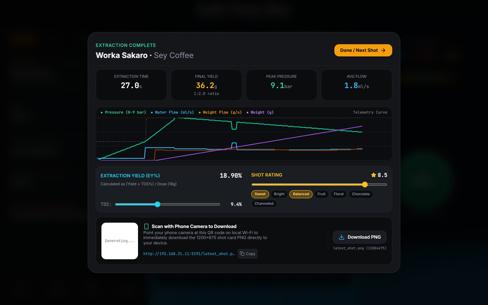
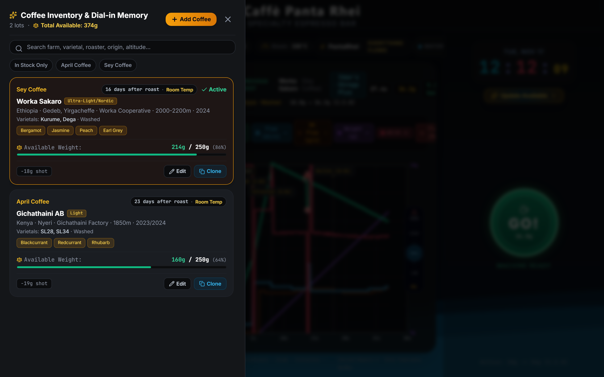
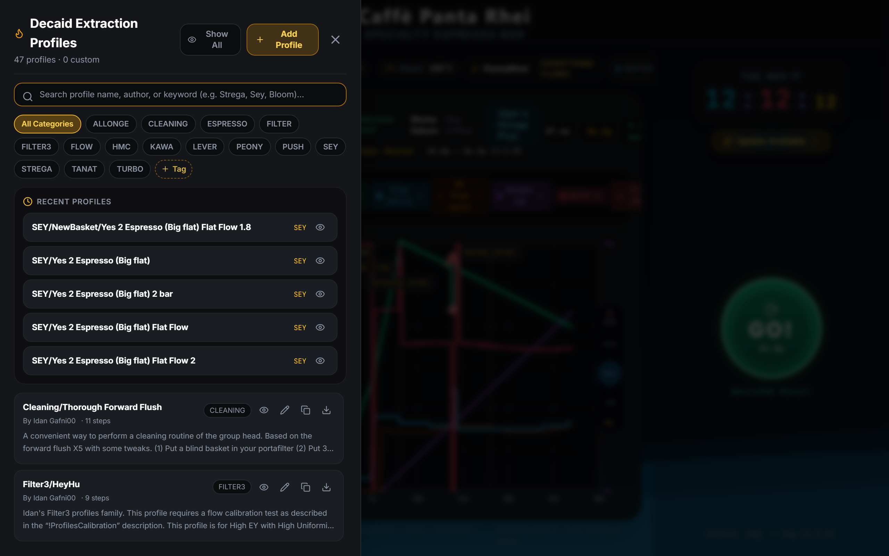

# PantaRhei

PantaRhei is a responsive, data-intensive web skin designed for Decaid on Decent Espresso DE1 and Bengle machines. Engineered for baristas, roasters, and profile developers, it combines live extraction physics, 60 FPS real-time telemetry, advanced bean inventory tracking, detailed equipment and puck prep management, intelligent maintenance scheduling, and seamless ecosystem integrations.

---

## Visual Tour & UI Showcase

| Main Cockpit & Channel Alert Detection | Live Real-Time Extraction Dashboard |
| :---: | :---: |
|  |  |

| Post-Shot Summary & Instant QR Sharing | Specialty Coffee & Bean Cellar |
| :---: | :---: |
|  |  |

| Curated Decaid v2 Profiles Library | Historical Extraction Archive |
| :---: | :---: |
|  |  |

| Dedicated Shot Curve Inspector | Machine Maintenance & Pairing |
| :---: | :---: |
|  |  |

| Equipment & Puck Prep Routine | DE1 Machine Connection & Setup Wizard |
| :---: | :---: |
|  |  |

---

## Key Features

### 1. Live Extraction & Telemetry Graphs
- **Real-Time Extraction Physics**: High-frequency telemetry visualizing pressure, water flow, gravimetric flow, temperature, scale weight, and puck resistance ($R = P/F^2$).
- **Dual Needle & Gauge Cockpit**: Real-time extraction gauge displaying instant head pressure and flow rate needles with responsive digital telemetry.
- **Step Names & Phase Indicators**: Clearly displays current and upcoming profile steps (e.g., Pre-infusion, Soak, Pressure Ramp, Flow Hold, Decline) along with their names, target parameters, and step timers directly aligned with the graph.
- **Channeling Detection Flags**: Automatically flags potential channeling and flow spikes in real time to diagnose puck degradation and grind distribution issues (with prominent crimson warning badges on the graph).
- **Interactive Data Inspector**: Continuous point-by-point scrubbing window across both live and historical curves, exposing exact pressure, flow, temperature, weight, and resistance data at every sub-second point along the timeline.
- **Cockpit Operation Modes**: Dedicated operational modes for Coffee, Steam, Hot Water, and Rinse, featuring automatic UL safety compliance detection to switch seamlessly between software triggers and hardware buttons.

### 2. Auto QR & Shot Sharing
- **Instant Shot Card & QR Sharing**: Automatically generates an offline QR code and downloadable shot summary card for the last shot.
- **Mobile Camera Scan**: Easily scan the QR code with any phone camera to transfer recipe parameters, extraction metrics, equipment setup, and shot images without requiring internet access or cloud logins.

### 3. Equipment Management & Puck Preparation Technique
- **Complete Hardware Catalog**: Dedicated equipment management tracking 8 distinct gear categories:
  - **Grinders** (flat, conical, hybrid)
  - **Burr Sets** (geometry, diameter, coatings)
  - **Precision Baskets** (standard, high-extraction, nano-coated)
  - **Bluetooth Scales** (Decent, Felicita, Acaia, Bookoo)
  - **Tampers** (calibrated spring, palm, flat, convex)
  - **Distributors & Levelers**
  - **WDT Tools** (planetary, spinning, needle diameter)
  - **RDT Techniques** (sprays, droplets, mist)
- **Left Pane Quick Selection**: An interactive "Equipment & Prep" card on the left cockpit pane displays active gear at a glance. Tapping it opens the selection modal to quickly assign or swap tools.
- **Dynamic Next-Shot Persistence**: Changing equipment or prep techniques in the left pane updates immediately and applies automatically to the very next shot without requiring restarts or menu navigation.
- **Recorded in Decaid Shot Files**: Every completed shot permanently records the active hardware gear and puck preparation routine into Decaid's system files—written to both Decaid JSON format and legacy TCL `.shot` files in the `history/` directory.
- **Editable in History View**: Baristas can reopen any past shot in the history drawer and click "Edit Shot" to modify equipment (Grinder, Burrs, Scale, Basket, Grind Size, Water Temp, Tampers, WDT Tools, RDT Prep, and Notes). Saving instantly updates the record, re-writes the Decaid shot file, and re-syncs to DYE2.

### 4. Coffee Bean Inventory & Cellar
- **Tagging & Metadata**: Comprehensive multi-criteria organization supporting custom tags, roaster, origin country, region, farm, varietals, process, roast date, crop year, and sensory tasting notes.
- **Storage Method Indication**: Explicit indicators for storage conditions, including room temperature storage and freezer stasis tracking (freezer date, thaw status, and frozen shelf-life protection).
- **Remaining Coffee Calculation**: Automatically recalculates remaining grams after every brew based on recipe dose, warning when a bag is running low or empty.
- **Resting & Peak Window Calculator**: Real-time counter showing days off roast, active resting countdown, and optimum peak flavor window.
- **One-Click Lot Duplication**: Quickly clone existing bean cards when opening new bags or successive roast batches of the same bean.

### 5. Ecosystem & Plugins Integration
- **Decaid Plugin Architecture**: Direct bridge with Decaid's native plugin manager to coordinate external tools and services.
- **Describe Your Espresso (DYE2)**: Bi-directional synchronization with the DYE2 plugin (`dye2.reaplugin`). Synchronizes full extraction curves, TDS, extraction yield (EY%), sensory tasting descriptors, together with the active equipment inventory and puck prep technique for comprehensive sensory analysis.
- **Visualizer.coffee Integration**: Cloud export bridge to upload shot profiles, curves, and equipment metadata directly to Visualizer.coffee for deep online analysis and community sharing.

### 6. Backup & Cross-Skin Synchronization
- **Complete Backup Envelopes**: Export and restore full configuration archives including master settings, bean inventory, equipment profiles, screensaver preferences, and shot logs.
- **Smart Deduplication**: Preview diffs during backup restore, preventing duplicate entries across profiles, beans, and historical shots.
- **Cross-Skin Compatibility**: Automatically dual-persists newly authored and edited profiles to both Decaid `profiles_v2/` and legacy `profiles/` / `profiles2/` folders, and writes shots to standard `history/` paths. This ensures you can switch between PantaRhei, other Decaid skins, or the original de1app without losing data.
- **Onboarding Folder Sync**: Automatically detects and syncs existing shot history and profile libraries on first launch, ensuring historical records and profiles from previous skins are immediately available.

### 7. Firmware & Software Update Management
- **System Version Monitoring**: Live detection and reporting of Decaid tablet software and DE1 machine firmware versions.
- **Daily Automated Checks**: Automatic daily verification for available software and firmware updates.
- **Smart Update Controls**: Dedicated update triggers in the Pairing tab (DE1 section) that remain gracefully disabled until an actual update is available.
- **Header Notification Badge**: When an update is detected, an "Update Available" notification indicator appears on the right pane below the clock, enabling one-click navigation directly to the Pairing settings to execute the update.
- **Release Channel Selection**: Configurable release stream support (Stable, Beta, and Nightly) to choose between proven stability and bleeding-edge experimental capabilities.

### 8. Machine Maintenance Assistant
- **Routine Maintenance Automation**: Assists baristas with essential machine hygiene and preventative care, tracking both daily cleaning cycles and long-term descaling schedules.
- **Group Head Cleaning Reminders**: Configurable reminder trigger (default: every 2 days, configurable from 1 to 30 days) to run a forward flush cleaning routine with a blind basket and cleaning detergent. Accurately tracks the timestamp of the last completed cleaning.
- **Machine Descaling Triggers**: Configurable monthly intervals (default: 2 months, configurable up to 12 months) tracking boiler and hydraulic circuit descaling.
- **Direct Easy Access & One-Click Context Switch**: When a cleaning or descale operation is due, a prominent notification button appears on the right pane directly below the "Update Available" badge. Clicking it immediately transitions the skin into the relevant cleaning context, pre-selecting the cleaning profile (`Cleaning/Thorough Forward Flush`) or descaling workflow.
- **Pairing Tab Integration**: Located cleanly between the Decent DE1 Connection card and the Bluetooth Scale Pairing card in Settings, providing interval sliders, elapsed time readouts, and one-tap "Mark Cleaned Today" / "Mark Descaled Today" actions.

### 9. Profile Suite & Editor
- **Decaid v2 Profile Editor**: Visual designer for building and fine-tuning multi-step pressure, flow, and temperature profiles with exit limits and sensor triggers.
- **47 Included Release Profiles**: Curated profiles authored by Idan Gafni covering modern specialty styles (SEY Coffee flat and constant flow, Push MaX-Traction, Peony lever and multi-stage, Filter 3 brews, Tanat Witch HUnt, and Niche Turbo Bloom).

### 10. Customizable Ambient Screensaver & Floating Clock
- **Idle Activation Delay**: Configurable inactivity timer (1, 2, 5, 10, 15, or 30 minutes) before the screensaver engages.
- **Custom Image Slideshow**: Select any local directory (e.g. tablet photo gallery, custom coffee photography) with configurable slide intervals (5–60s) and random shuffling.
- **Dimming & Visual Presentation**: Adjustable screen dimming (10% to 100%) and image fit styling (`contain_blur` with ambient backdrop glow, or full `cover`).
- **Anti-Burn-In Protection**: Dynamic clock drifting across display quadrants with adjustable drift speeds (slow, medium, dynamic) to protect tablet and OLED panels from static image burn-in.
- **Multi-Zone Clock Color Customization**: Complete color personalization with dedicated hex color pickers for every section of the floating clock:
  - Date
  - Hours
  - Minutes
  - Seconds
  - Separators / Colons
- **Typography Selection**: Choose between monospaced, modern sans-serif, or classic terminal font styles.
- **Responsive Wakeup**: Instant wakeup on touchscreen tap, mouse movement, or automated machine events (such as boiler pre-heating or extraction initiation).

---

## Resolution & Display

PantaRhei is optimized for the standard Decent DE1 landscape tablet resolution:
- **Target Resolution**: `1340 × 800`
- **Minimum Responsive Resolution**: `1005 × 552`

---

## Installation in Decaid

1. Copy or clone this repository into the Decaid `skins/` directory on your DE1 tablet:
   ```bash
   cd ~/decaid/skins/
   git clone https://github.com/e-done1/pantarhei.git pantarhei
   ```
2. Open Decaid **Settings** $\rightarrow$ **Skins** and select **PantaRhei**.

---

## Development

- **Prerequisites**: Node.js 18+ and npm
- **Install dependencies**: `npm install`
- **Run test suite**: `npm test`
- **Production build**: `npm run build`
