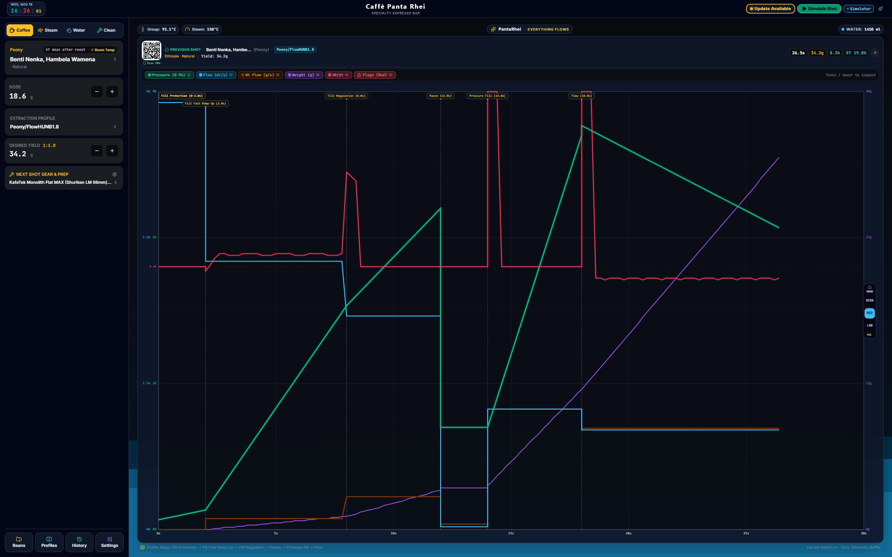
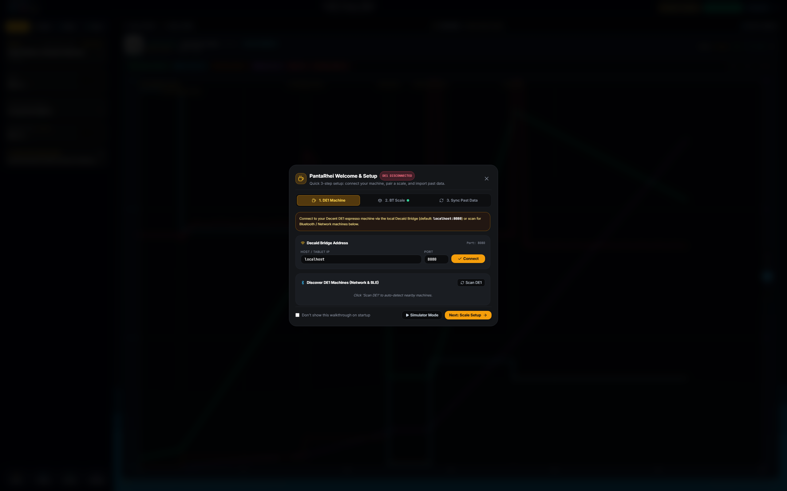

# PantaRhei

PantaRhei is a responsive, data-intensive web skin designed for Decaid on Decent Espresso DE1 and Bengle machines. Engineered for baristas, roasters, and profile developers, it combines live extraction physics, 60 FPS real-time telemetry, advanced bean inventory tracking, detailed equipment and puck prep management, intelligent maintenance scheduling, and seamless ecosystem integrations.

---

## Visual Tour & UI Showcase

| Main Cockpit & Channel Alert Detection | Live Real-Time Extraction Dashboard |
| :---: | :---: |
|  |  |

| Post-Shot Summary & Instant QR Sharing | Specialty Coffee & Bean Cellar |
| :---: | :---: |
|  |  |

| Curated Decaid v2 Profiles Library | Historical Extraction Archive |
| :---: | :---: |
|  |  |

| Dedicated Shot Curve Inspector | Machine Maintenance & Pairing |
| :---: | :---: |
|  |  |

| Equipment & Puck Prep Routine | DE1 Machine Connection & Setup Wizard |
| :---: | :---: |
|  |  |

---

## Key Features

### 1. Live Extraction & Telemetry Graphs
- **Real-Time Extraction Physics**: High-frequency 60 FPS telemetry visualizing pressure, water flow, gravimetric flow, temperature, scale weight, and puck resistance ($R = P/F^2$).
- **Dual Automotive Needle Gauges**: Real-time extraction meters displaying instant head pressure (0–9 bar) and flow rate (0–8 ml/s) needles with dynamic sweep geometry, digital telemetry, and peak hold indicators.
- **Step Names & Phase Indicators**: Clearly displays current and upcoming profile steps (e.g., Pre-infusion, Soak, Pressure Ramp, Flow Hold, Decline) along with their names, target parameters, and step timers directly aligned with the graph.
- **Channeling Detection & dR/dt Derivative Math**: Automatically flags potential channeling using mathematical central difference derivative ($dR/dt$) monitoring puck resistance rate of change, displaying debounced warning badges directly on the graph.
- **Interactive Data Inspector**: Continuous point-by-point scrubbing window across both live and historical curves with sub-second spline interpolation, exposing exact pressure, flow, temperature, weight, and resistance data at every sub-second point along the timeline.
- **Cockpit Operation Modes & Safety Interlocks**: 4 dedicated operational tabs for Coffee, Steam, Hot Water, and Maintenance (flush/rinse/descale) with context-aware "Go!" button halos, water tank level protection (<250ml cutoff), heating blocker warnings, and UL safety compliance detection.

### 2. Auto QR & Offline Shot Sharing
- **Instant Shot Card & QR Sharing**: Automatically generates an offline QR code and downloadable 1200×675 shot summary card for the last shot.
- **Mobile Camera Scan**: Easily scan the QR code with any phone camera on the local network to download recipe parameters, extraction metrics, equipment setup, and shot curve images without requiring internet access or cloud logins.
- **Post-Shot Sensory Evaluation**: Interactive post-shot drawer capturing 1–5 star ratings, TDS%, calculated Extraction Yield (EY%), dial-in grind adjustments, and barista notes with instant synchronization to Decaid history and DYE2.

### 3. Equipment Management & Puck Preparation Routine
- **Complete Hardware & Cold Storage Catalog**: Dedicated equipment management tracking 9 distinct gear and storage categories:
  - **Grinders** (flat, conical, hybrid)
  - **Burr Sets** (geometry, diameter, coatings)
  - **Precision Baskets** (standard, high-extraction, nano-coated)
  - **Bluetooth Scales** (Decent, Felicita, Acaia, Bookoo)
  - **Tampers** (calibrated spring, palm, flat, convex)
  - **Distributors & Levelers**
  - **WDT Tools** (planetary, spinning, needle diameter)
  - **RDT Techniques** (sprays, droplets, mist)
  - **Cold Storage & Freezers** (Standard Freezer -18°C, Deep Freezer -40°C, and custom freezers with configurable cabin temperatures and aging slowdown physics)
- **Left Pane Quick Selection**: An interactive "Equipment & Prep" card on the left cockpit pane displays active gear at a glance. Tapping it opens the selection modal to quickly assign or swap tools.
- **Dynamic Next-Shot Persistence**: Changing equipment or prep techniques in the left pane updates immediately and applies automatically to the upcoming extraction without requiring restarts or menu navigation.
- **Recorded in Decaid Shot Files**: Every completed shot permanently records the active hardware gear and puck preparation routine into Decaid's system files—written to both Decaid JSON format and legacy TCL `.shot` files in the `history/` directory.
- **Editable in History View**: Baristas can reopen any past shot in the history drawer and click "Edit Shot" to modify equipment (Grinder, Burrs, Scale, Basket, Grind Size, Water Temp, Tampers, WDT Tools, RDT Prep, and Notes). Saving instantly updates the record, re-writes the Decaid shot file, and re-syncs to DYE2.

### 4. Coffee Bean Cellar & Storage Physics
- **Tagging & Terroir Metadata**: Comprehensive multi-criteria organization supporting custom tags, roaster, origin country, region, farm, varietals, process, roast date, crop year, and sensory tasting notes.
- **Resting Countdown & Aging Calculator**: Real-time counter showing elapsed calendar days off roast (`X days after roast`) and active resting countdown based on the roaster/barista recommended resting period (e.g. `Day 5/14 — 9d to rest`).
- **Cold Storage Physics & Multi-Freezer Stasis**: Advanced physics-based aging calculation based on freezer cabin temperature and freezing date:
  - **Freezer Date Tracking**: Date picker for the date/time placed in freezer (`Date Put in Freezer`) with "Today" shortcut and live counter (`❄️ X days in freezer`).
  - **Continuous Temperature Slowdown Physics**: -18°C slows aging by a factor of 12 (12 days in freezer = 1 day at room temp); $\le -40^\circ\text{C}$ slows aging by a factor of 50 (50 days in freezer = 1 day at room temp), continuously interpolated for intermediate and ultra-low freezers.
  - **Physiological "Actual" Aging Calculation**: Computes effective physiological aging ($D_{actual} = D_{room} + D_{frozen} / F$) and surfaces live effective aging tags (`⚡ ~Y.Yd actual`) on active bean cards in the left pane and the cellar drawer.
  - **Multi-Freezer Lot Assignment**: Supports multiple freezers with distinct cabin temperatures in equipment inventory, allowing each bean lot to be assigned to a specific freezer or ambient room storage.
- **Fast Inverted Multi-Token Search**: Real-time indexed search matching across origin country, region, farm, varietals, process, roast profile, tasting notes, and roaster, paired with instant in-stock filtering.
- **Remaining Coffee Tracking & Quick Dose Decrement**: Automatically recalculates remaining grams after every brew based on recipe dose, with one-tap -18g dose subtraction and visual low-stock warning indicators.
- **One-Click Lot Duplication**: Quickly clone existing bean cards when opening new bags or successive roast batches of the same bean.

### 5. Ecosystem & Plugins Integration
- **Decaid Plugin Architecture**: Direct bridge with Decaid's native plugin manager to coordinate external tools and services.
- **Describe Your Espresso (DYE2)**: Bi-directional synchronization with the DYE2 plugin (`dye2.reaplugin`). Synchronizes full extraction curves, TDS, extraction yield (EY%), sensory tasting descriptors, together with the active equipment inventory and puck prep technique for comprehensive sensory analysis.
- **Visualizer.coffee Integration**: Cloud export bridge with token authentication, automatic upload toggle, privacy visibility controls (public, unlisted, private), and default grinder/burr mappings to upload shot profiles and curves directly to Visualizer.coffee.

### 6. Backup & Cross-Skin Interoperability
- **Complete Backup Envelopes**: Export and restore full configuration archives including master settings, bean inventory, equipment profiles, screensaver preferences, and shot logs.
- **Smart Deduplication & Diff Preview**: Preview added, updated, and existing records before applying changes during backup restore, preventing duplicate entries across profiles, beans, and historical shots.
- **Cross-Skin Dual-Persistence**: Automatically dual-persists newly authored and edited profiles to both Decaid `profiles_v2/` and legacy `profiles/` / `profiles2/` folders, and writes shots to standard `history/` paths. This ensures seamless interoperability when switching between PantaRhei, DYE2, other Decaid skins, or the original de1app without losing data.
- **Onboarding Folder Sync & Migration**: Automatically scans, deduplicates, and migrates existing shot history and profile libraries on first launch, ensuring historical records and profiles from previous skins are immediately available.

### 7. Firmware & Software Update Management
- **System Version Monitoring**: Live detection and reporting of Decaid tablet software and DE1 machine firmware versions.
- **Daily Automated Checks**: Automatic daily verification for available software and firmware updates.
- **Smart Update Controls**: Dedicated update triggers in the Pairing tab (DE1 section) that remain gracefully disabled until an actual update is available.
- **Header Notification Badge**: When an update is detected, an "Update Available" notification indicator appears on the right pane below the clock, enabling one-click navigation directly to the Pairing settings to execute the update.
- **Release Channel Selection**: Configurable release stream support (Stable, Beta, and Nightly) to choose between proven stability and bleeding-edge experimental capabilities.

### 8. Machine Maintenance Assistant
- **Routine Maintenance Automation**: Assists baristas with essential machine hygiene and preventative care, tracking both daily cleaning cycles and long-term descaling schedules.
- **Group Head Cleaning Reminders**: Configurable reminder trigger (default: every 2 days, configurable from 1 to 30 days) to run a forward flush cleaning routine with a blind basket and cleaning detergent. Accurately tracks the timestamp of the last completed cleaning.
- **Machine Descaling Triggers**: Configurable monthly intervals (default: 2 months, configurable up to 12 months) tracking boiler and hydraulic circuit descaling.
- **Direct Easy Access & One-Click Context Switch**: When a cleaning or descale operation is due, a prominent notification button appears on the right pane directly below the "Update Available" badge. Clicking it immediately transitions the skin into the relevant cleaning context, pre-selecting the cleaning profile (`Cleaning/Thorough Forward Flush`) or descaling workflow.
- **Pairing Tab Integration**: Located cleanly between the Decent DE1 Connection card and the Bluetooth Scale Pairing card in Settings, providing interval sliders, elapsed time readouts, and one-tap "Mark Cleaned Today" / "Mark Descaled Today" actions.

### 9. Profile Suite & Editor
- **Decaid v2 Profile Builder & Editor**: Visual designer for building and fine-tuning multi-step profiles, configuring step names, pump modes (Flow Control vs. Pressure Control), target pressure/flow values, step duration timers, target temperature, target dose, and target yield.
- **47 Included Release Profiles**: Curated profiles authored by Idan Gafni covering modern specialty styles (SEY Coffee flat and constant flow, Push MaX-Traction, Peony lever and multi-stage, Filter 3 brews, Tanat Witch HUnt, and Niche Turbo Bloom).
- **Profile Visibility & Organization**: Hide or unhide profiles with one-tap eye icons, assign custom category tags, search with instant scoring, and sort alphabetically from A to Z.

### 10. Customizable Ambient Screensaver & Floating Clock
- **Idle Activation Delay**: Configurable inactivity timer (1, 2, 5, 10, 15, or 30 minutes) before the screensaver engages.
- **Default Monochromatic Collection (Special Thanks)**: Includes 16 bundled monochromatic specialty coffee and Decent espresso wallpapers formatted for tablet displays. *Special thanks to **Jeremy Clark** for generously contributing these default screensaver images.*
- **Local Image Folder Selection**: Dedicated folder picker allowing baristas to choose any local folder containing images (e.g. tablet photo gallery, custom roast and cafe photography). Automatically scans, previews, and caches the image pool in IndexedDB for persistent slideshow playback.
- **Dimming & Visual Presentation**: Adjustable screen dimming (10% to 100%) and image fit styling (`contain_blur` with ambient backdrop glow, or full `cover`).
- **Anti-Burn-In Protection**: Dynamic clock drifting across display quadrants with adjustable drift speeds (slow, medium, dynamic) to protect tablet and OLED panels from static image burn-in.
- **Multi-Zone Clock Color Customization**: Complete color personalization with dedicated hex color pickers for every section of the floating clock:
  - Date
  - Hours
  - Minutes
  - Seconds
  - Separators / Colons
- **Typography Selection**: Choose between monospaced, modern sans-serif, or classic terminal font styles.
- **Responsive Wakeup**: Instant wakeup on touchscreen tap, pointer movement, or automated machine events (such as boiler pre-heating or extraction initiation).

### 11. Home Cafe Header & Space Protection
- **Customizable Cafe Identity**: Personalize your coffee bar with custom cafe title and subtitle directly from Settings Appearance.
- **Strict 68px Vertical Height Clamping**: Guaranteed space protection ensuring the header stripe never exceeds 68px, preventing vertical scrollbars on standard 1340×800 DE1 landscape tablet screens.
- **Intelligent Auto-Downscaling**: Automatically recalculates and scales typography (from 72px down to safe bounds) when lengthy names or subtitles are entered, alerting the barista with real-time fit status.

### 12. Built-in Decaid Simulator Fallback
- **Hardware-Free Testing & Development**: Full offline simulation engine producing realistic DE1 pressure, flow, gravimetric scale weight, resistance, and channeling telemetry, enabling skin evaluation, feature development, and demonstration without physical machine connection.

---

## Resolution & Display

PantaRhei is optimized for the standard Decent DE1 landscape tablet resolution:
- **Target Resolution**: `1340 × 800`
- **Minimum Responsive Resolution**: `1005 × 552`

---

## Installation in Decaid

1. Copy or clone this repository into the Decaid `skins/` directory on your DE1 tablet:
   ```bash
   cd ~/decaid/skins/
   git clone https://github.com/e-done1/pantarhei.git pantarhei
   ```
2. Open Decaid **Settings** $\rightarrow$ **Skins** and select **PantaRhei**.

---

## Development

- **Prerequisites**: Node.js 18+ and npm
- **Install dependencies**: `npm install`
- **Run test suite**: `npm test`
- **Production build**: `npm run build`
